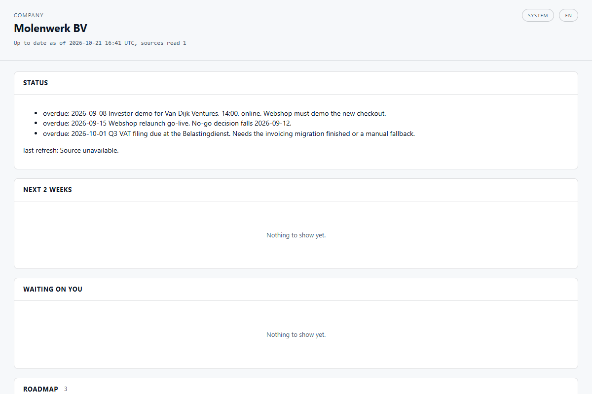
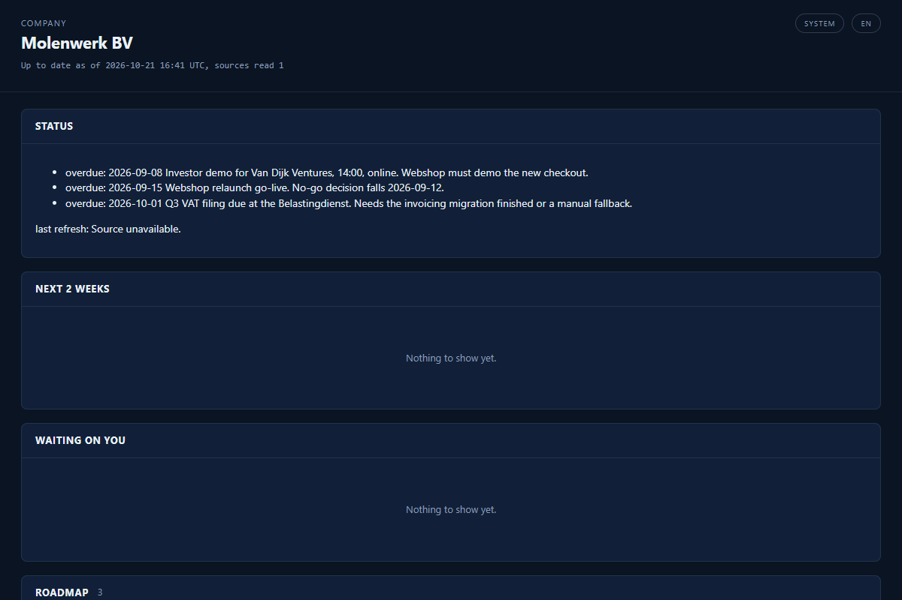
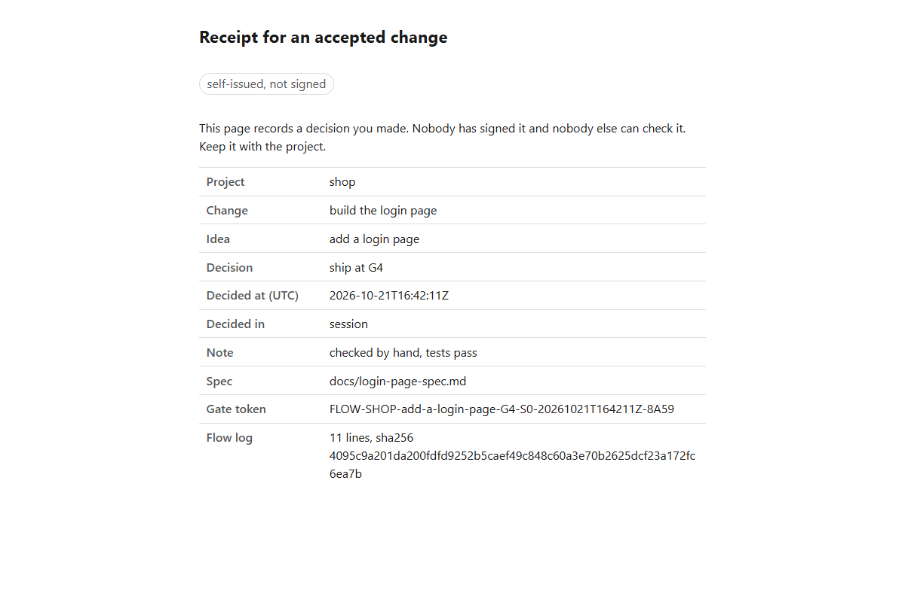
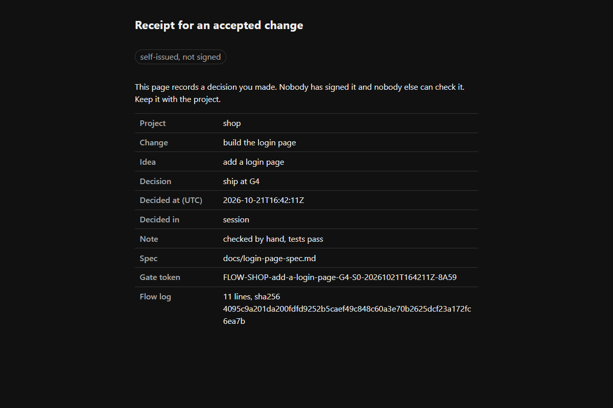

# Groundwork

Groundwork is a folder structure, one loop and a board for working with AI agents. It keeps the
plans, the decisions and the record in plain files in your own folder, so no chat window holds
the only copy.

## 1. What it is

Groundwork is for a person or a small team that works with an AI agent every day and wants to
know what was decided, by whom, and what can be undone. It is a set of plugins for Claude Code
and Claude Desktop, plus plain Markdown that other tools can read. The engine is Python and needs
nothing beyond the standard library.

You get four things: a folder skeleton for a company, a department or a project; one loop
(`one-loop`) that takes an idea through a plan, a spec, the work and a review with four gates
where you decide; a board that draws your folders as one HTML page; and an agent policy that
makes the agent read-only until you say otherwise.

## 2. Goals and benefits

- **The record lives in your folder.** A flow is plain files: `flow.json` and a log. Look at
  `templates\skeleton\` and `templates\molenwerk\` for the layout.
- **You decide at the gates.** The engine has four: plan, spec, ship, learn. No step moves
  without your verdict. `plugins\groundwork\skills\one-loop\SKILL.md` is the whole procedure.
- **A receipt when you accept.** Shipping at the last gate writes a readable page and a JSON file
  (screenshots below). Hold and park write none; `plugins\groundwork\engine\groundwork\test_gw.py`
  shows both cases.
- **The agent starts read-only.** It may write drafts, it cannot send, and it cannot delete
  without a named person. Every write is logged with a receipt and an undo note. The rules are one
  plain file: `plugins\groundwork-mods\policy\agent-policy.json`.
- **A board that only reads.** `plugins\groundwork\board\render_board.py` draws a folder tree as
  one static HTML file.

What it costs you: the gates are slower than letting an agent run. That is on purpose. If you
want a machine that ships without asking you, this is the wrong tool.

I measured what I claim here by running it. The engine carries 987 passing tests, the board 185,
the mods 25 and the `siteoffice-git` engine 448, all green on Windows at this release. That last
suite builds real git repositories and takes about 25 minutes. Claude Code wrote most of the code
and text of this release. I set the scope and I decide what ships.

## 3. Screenshots

All four are rendered from this release. The receipt page is what you get when you ship.






## 4. Install, no terminal

1. Open Claude Desktop. Click your name (bottom left), then Settings, then Plugins, then Add
   marketplace.
2. Paste `siteoffice/groundwork`.
3. Install `groundwork`. Install `groundwork-mods` as well for the Setup Doctor and the agent
   policy.
4. You need Python 3.8 or newer on the computer. If you are not sure, the Setup Doctor tells you.

The full steps for Windows and macOS are in [docs/setup-guide.md](docs/setup-guide.md).

## 5. Install, developers

```text
# runs in: inside Claude Code, any session.
/plugin marketplace add siteoffice/groundwork
/plugin install groundwork@groundwork
/plugin install groundwork-mods@groundwork
```

Choose user scope, or add `--scope user` to `claude plugin install`. A project-scope install loads
only in that folder.

Build and test from source:

```powershell
# runs in: PowerShell on Windows. cwd: the repo root of your checkout.
pwsh -NoProfile -File .\scripts\check-public-payload.ps1
cd .\plugins\groundwork\engine; py -3 -m pytest foreman groundwork -q
cd ..\; py -3 -m pytest board -q
cd ..\groundwork-mods; claude plugin test .
```

The engine and the board are vendored from Siteoffice by `scripts\sync-engine.ps1`, never edited
by hand. The payload gate `scripts\check-public-payload.ps1` must exit 0 before any commit.

## 6. How to use: the first ten minutes

1. Open Claude Code in a project folder.
2. Type `/setup-doctor`. Fix what it lists.
3. Say: "Start a flow for adding a login page." `one-loop` creates the flow and walks you to
   the plan gate.
4. Answer each gate. At the ship gate, say "ship" if you accept the result. Your receipt lands
   in `flows\<project>\<slug>\receipts\`.
5. Want a folder structure for the whole company? Say "set up my company hub".

## 7. Roadmap

Next: a test run on a Mac, install screenshots for both systems, and a first run by someone who
did not build it, with their findings filed as issues. Not planned here: signing receipts and a
verify page (that is a separate product), a hosted version, a sprint runner, and Slack as the
default. See the [issue list](https://github.com/siteoffice/groundwork/issues).

## 8. Known bugs and limits

- **macOS is untested.** The code has no Windows-only calls and the guide has a macOS path, but
  nobody has run it on a Mac.
- **The board follows folders upward.** It looks for a funnel folder in the parent folders. Put
  your checkout somewhere with no `00_funnel` above it, or the board shows that funnel too.
- **The agent policy is a guardrail, not a lock.** It cannot see a link that leads out of a
  folder, and in work mode it cannot judge a command it does not know.
- **The work step runs in your session.** The engine ships no sprint runner.
- **`siteoffice-git` and the agent policy disagree on pushing.** The skill saves, proposes and
  lands a change with `git push` and a pull request. The policy blocks every push, in work mode
  too, so you run the push or the merge yourself. The skill's own engine ships in
  `plugins\groundwork\engine\sync`.
- **Where an organisation manages Claude Code, session-start hooks of plugins you install are
  skipped.** Claude Code says so under `/plugin`, Errors. The Setup Doctor names it as a
  recommended row. The mods then miss the reset after `/clear` and `/resume`; the agent policy
  hooks tool calls and keeps working. Only the organisation's managed settings can change this.
- **Cowork shows a warning about `groundwork-mods`.** It names an unknown `types` key in
  `plugin.json`. Safe to ignore: the key is the type contract Claude Code uses for the Setup
  Doctor, and Cowork does not run mods.

Report a bug with the issue template: the command, what it printed, and your system.

## 9. Licence, support and contact

MIT, see [LICENSE](LICENSE). Questions and bugs: open an issue. Anything else:
info@zerononsense.dev. Made by ZeroNonsense.dev.
