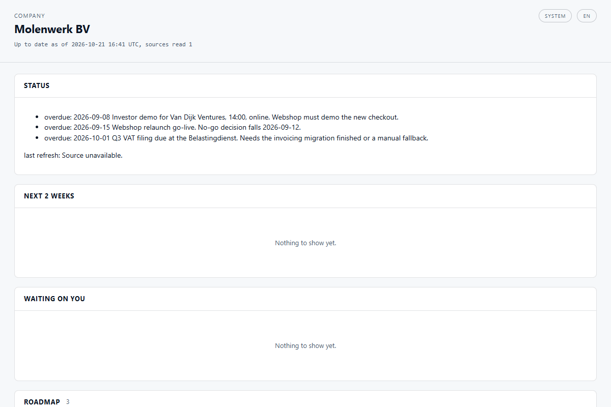
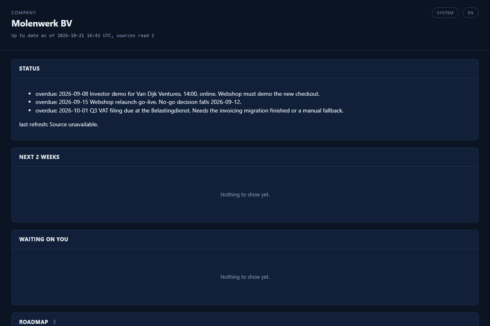
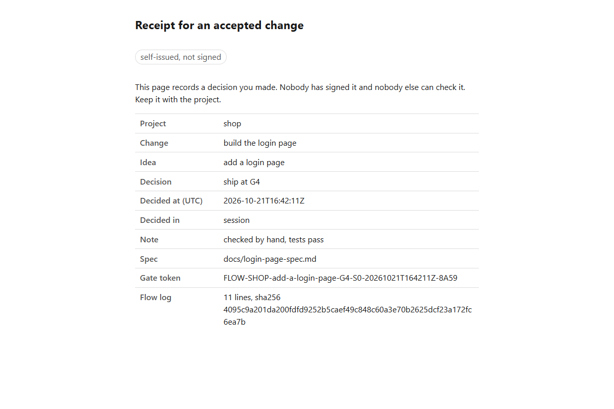
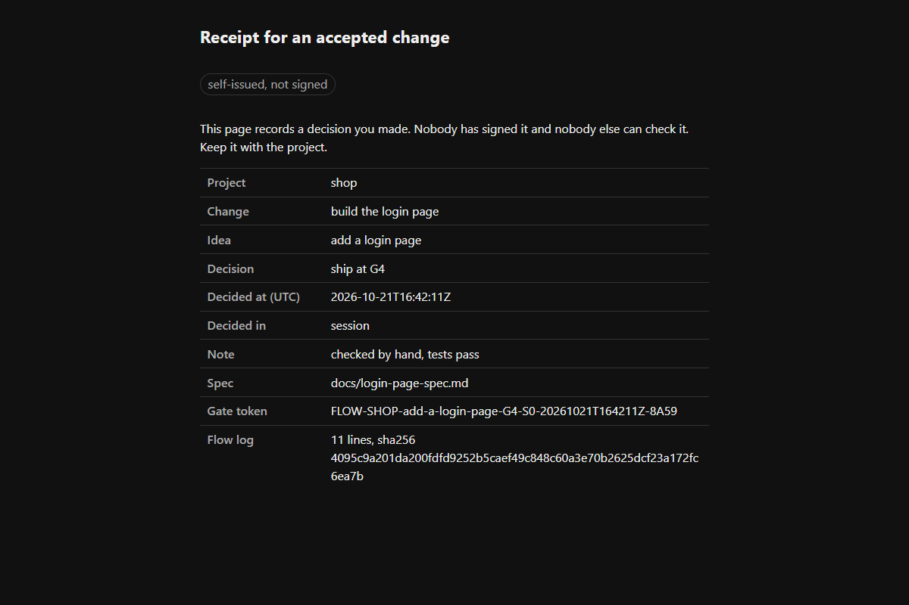

# Groundwork

Groundwork is a folder structure, one loop and a board for working with AI agents. It keeps the
plans, the decisions and the record in plain files in your own folder, so no chat window holds
the only copy.

## 1. What it is

Groundwork is for a person or a small team that works with an AI agent every day and wants to
know what was decided, by whom, and what can be undone. It is a set of plugins for Claude Code
and Claude Desktop, plus plain Markdown that other tools can read. The engine is Python and needs
nothing beyond the standard library.

You get four things: a folder skeleton for a company, a department or a project; one loop
(`one-loop`) that takes an idea through a plan, a spec, the work and a review with four gates
where you decide; a board that draws your folders as one HTML page; and an agent policy that
makes the agent read-only until you say otherwise.

### What needs BurnMon

BurnMon is a separate app that watches your agent sessions and writes a small snapshot file in
your home folder. Two things need it: the Fleet's BurnMon line and the Doctor's BurnMon line,
which both show whether BurnMon runs. Everything else in Groundwork works without it, the rest of
the Fleet and the whole Git lane included. The Doctor's line reads only the `written_at` field of `~/.burnmon/snapshot.json`. The Fleet also
reads how many sessions wait on you (`wait_counts`) and, per session, whether it is blocked or your
turn. It never reads titles, details or paths, so nothing from inside your sessions. The Fleet's line says "BurnMon is
running" with the snapshot's age when the file is younger than ten seconds, "BurnMon is not
running" when it is ten seconds or older or cannot be read, and "BurnMon is not installed" with
the link when the file is missing. BurnMon is linked, never bundled: [get it from its releases
page](https://github.com/siteoffice/burnmon/releases). Run `/setup-doctor` to see whether it is
running, installed but stopped, or missing.

### The Fleet and the Git lane

`groundwork-mods` carries two more parts. Both are off by default, and a switch that is off
registers nothing: no command, no hook, no output.

- **The Fleet** (`/fleet`) shows what waits on you in every session, this session's agents,
  threads and background shells, your other sessions and a usage band. Its other commands are
  `/thread` and `/threads` (a task in its own git worktree), `/burnmon` (the usage band on or off),
  `/blackbox` (a log of what Claude did, written as NDJSON; it is not tamper-proof: the file is rewritten whole
  and not protected against edits, and Claude can edit it in work mode), `/plain` and `/tower` (the old
  name of `/fleet`).
- **The Git lane** (`/git`) draws your change as one lane from changes to merged. The next step is
  one button, with the exact commands shown first. It also has a guard on Claude's risky git, a
  Test Bench and a PR Desk. In a Siteoffice repo the writes go through the `siteoffice-git` engine.
  The lane makes no model calls of its own; its "Ask Claude" buttons send a prompt in your session,
  which is a normal turn on your quota.

To switch them on, open `/config`, find the Groundwork Mods rows "Fleet" and "Git lane", or add
this to `settings.json`, then start a new session. The commands register when a session starts, so
an open session does not pick the switch up.

```json
{ "pluginConfigs": { "groundwork-mods": { "options": { "fleet": true, "gitLane": true } } } }
```

Plain Mode (`/plain`, inside the Fleet) is off until you switch it on. Then it makes small model
calls on your own quota: about 1,100 tokens for each "So what" and about 400 for each question
set, capped at 50,000 tokens a day. Each call adds one line to `~/.burnmon/overhead/<day>.ndjson`.

Do not switch on the Fleet or the Git lane in a session that also loads another plugin that
registers `/fleet`, `/git` or a git guard. Both would register the same commands. Both
register their commands on every surface (terminal, Desktop, mobile and VS Code).

### Retro

`retro` (in `plugins\groundwork\skills\retro`) is a monthly check-up of your own sessions of the
last N days (30 by default). It measures how many times you had to step in per finished piece of
work, silent failures, secret exposures, hook and MCP health, and which skills you used and which
you did not. It reads only your own transcripts on your machine, uploads nothing and never opens
a `.env` file. Secrets are scrubbed and never stored: the report keeps the session, the date and
the kind, nothing else.

The report lands in `<root>\retro\YYYY-MM\` as `report.md`, `report.html` and `metrics.json`. Each
separate world you name gets its own report in its own folder and is never mixed into the main
report. Gate patterns you declare are simple globs (`*` and `?`), not regular expressions. This
release only counts. The agent analysis and the guided apply come later. To start, say "retro".

A monthly scan can be set up. A script prints the plan; you run the register command yourself,
and nothing is registered for you.

## 2. Goals and benefits

- **The record lives in your folder.** A flow is plain files: `flow.json` and a log. Look at
  `templates\skeleton\` and `templates\molenwerk\` for the layout.
- **You decide at the gates.** The engine has four: plan, spec, ship, learn. No step moves
  without your verdict. `plugins\groundwork\skills\one-loop\SKILL.md` is the whole procedure.
- **A receipt when you accept.** Shipping at the last gate writes a readable page and a JSON file
  (screenshots below). Hold and park write none; `plugins\groundwork\engine\groundwork\test_gw.py`
  shows both cases.
- **The agent starts read-only.** It may write drafts, it cannot send, and it cannot delete
  without a named person. Every write is logged with a receipt and an undo note. The rules are one
  plain file: `plugins\groundwork-mods\policy\agent-policy.json`.
- **A board that only reads.** `plugins\groundwork\board\render_board.py` draws a folder tree as
  one static HTML file.
- **A git guard in agent sessions.** `plugins\groundwork\hooks\hooks.json` denies raw mutating git
  (`commit`, `push`, `merge` and the like) from the agent and points it at the `siteoffice-git`
  steps. `git status` and other read-only git still run.

What it costs you: the gates are slower than letting an agent run. That is on purpose. If you
want a machine that ships without asking you, this is the wrong tool.

I measured what I claim here by running it. The engine carries 1021 passing tests, the board 187,
the repository's pytest suite 628, the `siteoffice-git` engine 451 and the mods suite 209, all green on Windows at this release. macOS and Ubuntu are verified in CI as well: install-matrix run [41332885453](https://github.com/siteoffice/groundwork/actions/runs/41332885453) on commit `da04fd3` passed the engine, board, repository and mods suites and the plugin install steps on all three systems, and the install steps passed without a Claude login. [docs/install-matrix.md](docs/install-matrix.md) shows each step. The `siteoffice-git` engine suite is not in CI. Not verified: the Claude Desktop app install, and a live Claude Code session (the mods tests mock the host). The trust
tests that drive real git through the real `gitsafe.ts` need Node 22.18 or newer and are skipped when it is missing or older. That last
suite builds real git repositories and takes about 25 minutes. Claude Code wrote most of the code
and text of this release. I set the scope and I decide what ships.

## 3. Screenshots

All four are rendered from this release. The receipt page is what you get when you ship.

The guided tour in [docs/tour.md](docs/tour.md) explains every screen of a running flow and what to do next.






## 4. Install, no terminal

Claude Desktop runs on Windows and macOS. There is no Desktop app for Linux: on Linux, use Claude
Code from a terminal (section 5 and the setup guide).

1. Open Claude Desktop. Click your name (bottom left), then Settings, then Plugins, then Add
   marketplace.
2. Paste `siteoffice/groundwork`.
3. Install `groundwork`. Install `groundwork-mods` as well for the Setup Doctor and the agent
   policy.
4. You need Python 3.9 or newer on the computer. If you are not sure, the Setup Doctor tells you.

The full steps for Windows, macOS and Linux are in [docs/setup-guide.md](docs/setup-guide.md).
What CI proves on each system is in [docs/install-matrix.md](docs/install-matrix.md).

## 5. Install, developers

```text
# runs in: inside Claude Code, any session.
/plugin marketplace add siteoffice/groundwork
/plugin install groundwork@groundwork
/plugin install groundwork-mods@groundwork
```

Choose user scope, or add `--scope user` to `claude plugin install`. A project-scope install loads
only in that folder. Installing Claude Code itself, Python per system and the same steps as
terminal commands are in [docs/setup-guide.md](docs/setup-guide.md); the per-system CI results are
in [docs/install-matrix.md](docs/install-matrix.md).

Build and test from source:

```powershell
# runs in: PowerShell on Windows. cwd: the repo root of your checkout.
pwsh -NoProfile -File .\scripts\check-public-payload.ps1
py -3 -m pip install tzdata
cd .\plugins\groundwork\engine; py -3 -m pytest foreman groundwork -q
cd ..\; py -3 -m pytest board -q
cd ..\groundwork-mods; claude plugin test .
```

The engine and the board are vendored from Siteoffice by `scripts\sync-engine.ps1`, never edited
by hand. The payload gate `scripts\check-public-payload.ps1` must exit 0 before any commit.

### Before you rely on it

This is a beta, built and used daily by one person. It runs on your own machine and changes nothing
outside the folders you point it at. It comes with no warranty (see [LICENSE](LICENSE)).

What it does not do, or not yet:

- **Claude Desktop runs on Windows and macOS only.** There is no Desktop app for Linux, so Linux is
  command-line only: use Claude Code from a terminal.
- **Hooks can be skipped** on a Claude organisation with managed settings ("cc-plugin-sec-default
  runs first"); the Setup Doctor tells you when. The agent policy pack and the Git guard then do not
  run.
- **The Fleet and the Git lane are off by default.** Turn them on in the mods settings.
- **The plugin security scan** may show a Warn banner the first time, because the plugin ships hooks.
- **No Linear, Jira or GitHub Projects link** yet. The board reads your folders only.

### Feedback and issues

I want to hear what broke and what you expected instead.

1. **Bug**: open an issue with the "Bug" template. Include the version (Setup Doctor or the About
   line), your OS, and what you did just before. Never paste prompts, keys or customer data.
2. **"It did not do what I expected"**: use that template. This is the most useful one for me.
3. **Idea**: use the "Idea" template, one idea per issue.
4. **After two weeks**: answer the five questions in [FEEDBACK.md](FEEDBACK.md).

Response: I read every issue within two working days. Security problems: do not open a public
issue; mail info@zerononsense.dev.

## 6. The first 15 minutes, in a repo you already have

You do not need a new folder. Groundwork works in the repo you already use, and adds one folder
to it.

1. Install `groundwork` and `groundwork-mods` at user scope (section 4 or 5), then restart Claude
   Code. The mods load when a session starts.
2. Open Claude Code in the root of your repo and type `/setup-doctor`. Fix what it lists. If it
   says hooks are skipped, your Claude organisation manages settings: the agent policy and the Git
   guard do not run, and the rest still works.
3. Pick a change you were going to make anyway, a small bug or a small feature. Say: "Start a flow
   for <that change>." `one-loop` creates the flow and stops at the plan gate.
4. Answer the gates: plan (G1), spec (G2), ship (G4), learn (G3).
   [docs/tour.md](docs/tour.md) shows every screen and what to do next.
5. Say "ship" at G4 when you accept the result. The receipt lands in
   `flows\<project>\<slug>\receipts\`.

What lands in your repo: one `flows\` folder at the root, with the plan, the gate decisions and
the receipt. Commit it. The record then sits next to the change it describes, and a reviewer reads
both in the same pull request. If your team does not want it in the repo, add `flows/` to
`.gitignore`; the record then lives on your disk only.

What the agent may do there:

- **Read and write drafts, out of the box.** It does not change your code until you set
  `"mode": "work"` in `.groundwork\agent-policy.json` (see
  [Turn on write access](docs/setup-guide.md#turn-on-write-access)). Add `.groundwork/` to
  `.gitignore`. Sends and deletes stay blocked in work mode too.
- **Never commit, push or merge.** The Git guard blocks raw git from the agent. You commit
  yourself, in your own terminal, the way you do now.

Why the brakes: a plan nobody approved is a guess, and a chat window is a bad place to keep the
only copy of a decision. The gates make a change slower. They also leave a record you can read
next month, which is the part I wanted.

Fifteen minutes is my target, not a measurement: so far only I have run this. Question 1 in
[FEEDBACK.md](FEEDBACK.md) is how I find out.

Starting from an empty folder instead: say "set up my company hub", or copy
`templates\skeleton\`.

## 7. Roadmap

Next, in 0.5.0: the Fleet shows what waits on you from BurnMon's wait states, the engine fixes from
issue #105, the Claude Desktop install checked against Claude's new Plugins page, and install
screenshots from macOS. Then the first run by people who did not build it, a small group of
developers, with their findings filed as issues. Not planned here: signing receipts and a verify
page (that is a separate product), a hosted version, a sprint runner, and Slack as the default.
See the [issue list](https://github.com/siteoffice/groundwork/issues).

## 8. Known bugs and limits

- **The Claude Desktop install is not tested yet.** CI proves the command-line install and the
  tests on Windows, macOS and Linux ([docs/install-matrix.md](docs/install-matrix.md)). The Desktop
  route is checked by hand against Claude's new Plugins page, and that check has not run.
- **Retro on Cowork for macOS is unverified, and its touch classes are heuristics.** They are
  `metric_version 1`, so read the counts as a trend, not as a score.
- **Retro refuses any path with a component starting `.env`.** That includes a parent folder, so
  such a home path gives zero sessions, and the report says how many files were refused.
- **The retro report estimate shows assumptions, not live prices.**
- **The board follows folders upward.** It looks for a funnel folder in the parent folders. Put
  your checkout somewhere with no `00_funnel` above it, or the board shows that funnel too.
- **The agent policy is a guardrail, not a lock.** It cannot see a link that leads out of a
  folder, and in work mode it cannot judge a command it does not know.
- **The work step runs in your session.** The engine ships no sprint runner.
- **`siteoffice-git` and the agent policy disagree on pushing.** The skill saves, proposes and
  lands a change with `git push` and a pull request. The policy blocks every push, in work mode
  too, so you run the push or the merge yourself. The skill's own engine ships in
  `plugins\groundwork\engine\sync`.
- **The Git lane runs git when you press its button.** The agent policy blocks every agent push.
  A push or merge you start from a lane button is your own action, so the policy does not see it.
- **In a Siteoffice repo the Git lane, the Setup Doctor and the `siteoffice-git` launcher run only
  an engine you installed.** They take `SITEOFFICE_SYNC_DIR` first, else the engine the
  `groundwork` plugin ships. A repo can no longer name its own engine: `settings.git.engine` in
  `siteoffice.json` and `<repo>\sync\git_flow.py` are gone. They ignore `SITEOFFICE_SYNC_DIR` when
  it resolves inside the repo or any of its worktrees, because a repo's `.claude\settings.json`
  `env` block can set it. Paths are compared by real path (symlinks and junctions are followed);
  relative, drive-relative, UNC and device values, and a bare root, are ignored. The Setup Doctor
  says so in one line and names the reason (inside the repo, not an absolute path, or does not
  resolve), in the launcher's own words. In the launcher on Windows PowerShell the real-path check does not cover 8.3 short names,
  hard links, mapped drives, or a link swapped in between the check and the run.
- **The Fleet runs git only in a thread's own worktree, and hardened.** Every git call runs with
  `core.fsmonitor` off and no hooks path, `git diff` runs with no external diff, no textconv and
  submodules ignored (a submodule's own config can define a filter), and `gh` gets the same settings through environment variables (git 2.31 or newer; unverified: that gh passes them on to the git it starts). It follows a
  thread folder only under `.claude\worktrees`, only for thread agents, and only after a tool call
  that succeeded. It refuses to show a diff for a folder whose repo-local, worktree or command git
  config defines programs to run. A clean verdict is checked again on every refresh; an untrusted
  verdict stays for the session, so after you move a setting to your global git config you restart
  the session to open the lane again. Checked live on 2026-11-04: a new session clears the verdict. The check reads the repo's local, worktree and command settings for a list of keys that
  name a program to run (filters, `core.sshCommand`, pager and editor, diff commands, credential
  helpers, hooks, `gpg`, `alias` and `url` sections, includes, and more). It is a best-effort
  warning from a list of known settings, not a proof that git runs nothing else from a repo's
  config. Do not open a repo you do not trust in a session. A repo with submodules, or with a
  setting from that list (for example `git lfs install --local`), shows as closed; move the
  setting to your global git config. A default branch whose name starts with `-` is passed to
  `git switch` as an option (existing behaviour, not changed in G4).
- **A repo can hide settings from the Fleet's trust check.** A repo's own `.claude\settings.json`
  `env` block can set `GIT_CONFIG_GLOBAL` or `GIT_CONFIG_PARAMETERS`. Settings that git reads this
  way are not seen by the trust check, so only open the Fleet in repos you trust. The hardened git
  calls still override `core.fsmonitor` and `core.hooksPath` themselves.
- **The Git lane runs git hardened, and only in a folder it trusts.** Every git call it makes runs with core.fsmonitor off and no hooks path, git diff runs with no external diff, no textconv and submodules ignored, git status runs with submodules ignored, and gh gets the same settings through environment variables. That also means your own pre-commit and pre-push hooks do not run on the lane's own git calls, in a repo without the siteoffice-git engine. In a Siteoffice repo the lane's saves run through the engine, whose git calls are not hardened here (nothing in `plugins\groundwork\engine\sync\git_flow.py` overrides hooks), so the repo's own hooks run there. Before it runs git, the lane runs the Fleet's trust check on the session folder. In a folder it calls untrusted the lane only shows one line with the reason (the first setting that closed it, in parentheses): it saves, pushes and calls the engine for nothing, and runs no git beyond the read-only settings check itself (`git config`, `git rev-parse`) and no gh. The Git guard keeps full strength there: it still holds a push to the default branch (main, master and the name in `.git\refs\remotes\origin\HEAD`, read as a file and never with git, all count when the lane cannot ask; in a linked worktree it follows the `.git` file to the main repository's copy, and a repository with no such file, such as a reftable clone, protects main and master only; before the lane's first refresh the guard also counts main and master) and a write outside the folder. The trust check is a warning from a list of known settings, not a guarantee, and a repo's config can make git run a program in ways it does not name, so open the lane only in repos you trust. A clean verdict is checked again on every refresh; an untrusted verdict stays for the session, so after you move a setting to your global git config you restart the session to open the lane again (unverified: that a restart clears the verdict, a check in the live look). The guard shows the remote's default branch name in quotes, without control characters and cut at 60 characters. The siteoffice-git engine's own steps are not changed by this.
- **The Fleet's tick scan of `.claude\worktrees\agent-<id>` is unchanged.** It still looks in that
  folder for each known thread without waiting for a tool call.
- **Windows PowerShell 5.1 still cannot run the payload gate.** Run `scripts\check-public-payload.ps1`
  on `pwsh`. Inside a git work tree it checks the files git knows (tracked files, and new files that are not ignored), so a local ignored file does not fail it; elsewhere it checks every file in the folder. It reads the working tree copy of each file git lists, not the staged blob, so a hit staged and then removed from the working file is not seen.
- **The git guard needs Windows PowerShell or PowerShell 7, and Git Bash on Windows.** It runs
  `powershell`, else `pwsh`. With neither it does nothing and raw git is not blocked. Like the agent
  policy it is a guardrail, not a lock.
- **Where an organisation manages Claude Code, session-start hooks of plugins you install are
  skipped.** Claude Code says so under `/plugin`, Errors. The Setup Doctor names it as a
  recommended row. The mods then miss the reset after `/clear` and `/resume`; the agent policy
  hooks tool calls and keeps working. Only the organisation's managed settings can change this.
- **Cowork shows a warning about `groundwork-mods`.** It names an unknown `types` key in
  `plugin.json`. Safe to ignore: the key is the type contract Claude Code uses for the Setup
  Doctor, and Cowork does not run mods.

Report a bug with the issue template: the command, what it printed, and your system.

## 9. Licence, support and contact

MIT, see [LICENSE](LICENSE). Questions and bugs: open an issue. Anything else:
info@zerononsense.dev. Made by ZeroNonsense.dev.
