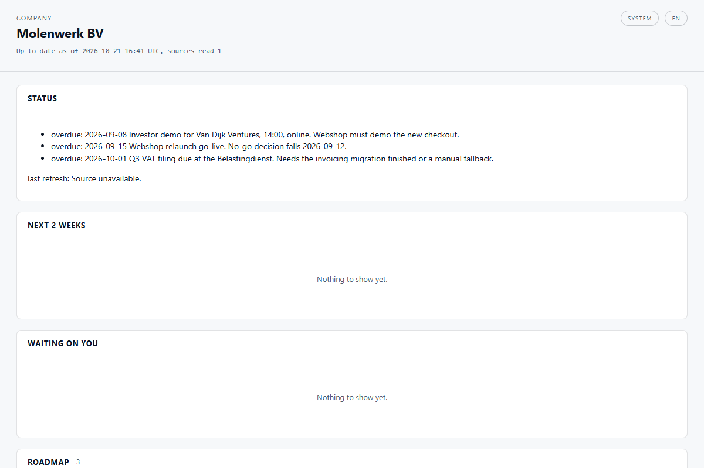
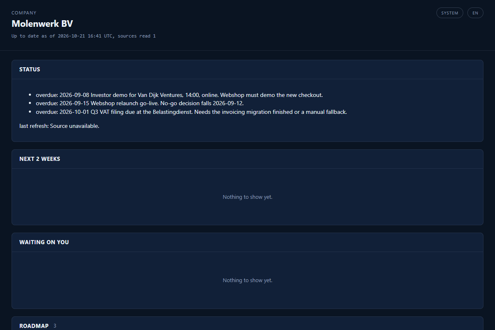
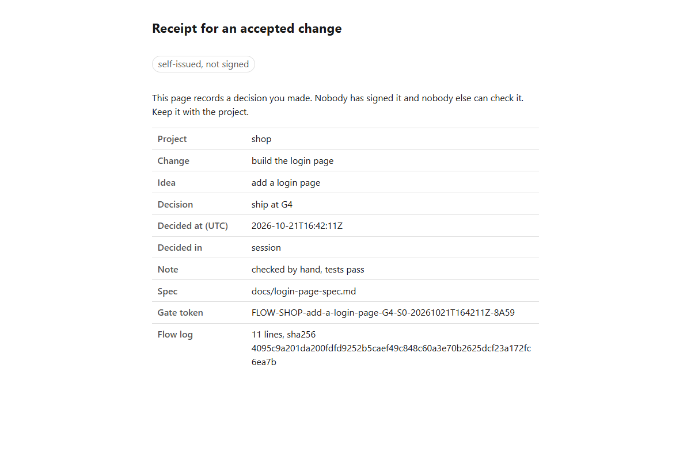
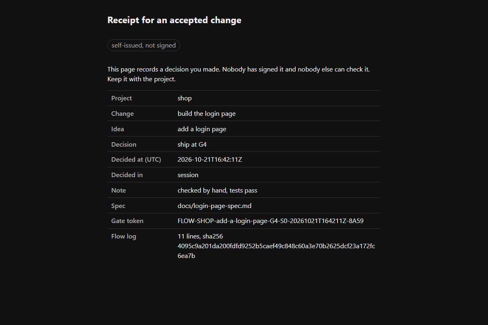

# Groundwork

Groundwork keeps the plan, the decisions and the record of AI work in plain files in your own
folder. No chat window holds the only copy.

## 1. What it is

Groundwork is a folder structure, one loop and a board for a person or small team that works with
an AI agent every day. It lets you say what was decided, by whom, and what can be undone, because
the agent stops at four gates and you decide.

It is a set of plugins for Claude Code and Claude Desktop, plus plain Markdown that other tools
can read. The engine is Python and needs nothing beyond the standard library. The current version
is the top entry of [CHANGELOG.md](CHANGELOG.md), one clock for the whole repository.

## 2. Where it fits

Groundwork is one part of a small set of tools. Each part does one job.

| Part | Job | Does Groundwork need it? |
|---|---|---|
| Foreman | The process: idea, plan, spec, work, review | No. `one-loop` carries the same four gates in a folder you control. |
| BurnMon and BurnMon Dev | Watching: tokens, cost, sessions | No. Only two status lines use it (below). |
| Control Centre | Steering: your folders and gates in one window | No. |
| Skills (`plugins\groundwork\skills`) | The tools you call by name | Yes. They are the product. |

What Groundwork needs: Python 3.9 or newer, and git for the Git lane. It needs no account, no
service and no network call to run a flow. Claude Desktop is not required: Claude Code in a
terminal works on Windows, macOS and Linux.

Each plugin has its own README: [plugins\groundwork](plugins/groundwork/README.md) (the skills,
the engine, the board, the git guard) and [plugins\groundwork-mods](plugins/groundwork-mods/README.md)
(Setup Doctor, agent policy, Fleet, Git lane).

### What needs BurnMon

BurnMon is a separate app that watches your agent sessions and writes a small snapshot file in
your home folder. Two things need it: the Fleet's BurnMon line and the Doctor's BurnMon line.
Both show whether BurnMon runs. Everything else works without it, the rest of the Fleet and the
whole Git lane included.

- The Doctor's line reads only the `written_at` field of `~/.burnmon/snapshot.json`.
- The Fleet also reads how many sessions wait on you (`wait_counts`) and, per session, whether it
  is blocked or your turn. It never reads titles, details or paths, so nothing from inside your
  sessions.
- The Fleet's line says "BurnMon is running" with the snapshot's age when the file is younger than
  ten seconds. It says "BurnMon is not running" when the file is ten seconds or older or cannot be
  read, and "BurnMon is not installed" with the link when the file is missing.

BurnMon is linked, never bundled: [get it from its releases
page](https://github.com/siteoffice/burnmon/releases). Run `/setup-doctor` to see whether it is
running, installed but stopped, or missing.

### How it compares

Groundwork compares on gates and receipts, not on spec files. I have not run it against any tool
below, so this table claims no result. Each row uses only what the linked source says.

| Group | What the source says | Groundwork's line | Source |
|---|---|---|---|
| Spec-driven frameworks: Spec Kit, OpenSpec, BMAD, Kiro | Published with a spec-driven development benchmark (Uvik, 50 tickets). | One loop with four gates where you decide, and a local receipt when you accept. | https://uvik.net/blog/spec-driven-development-benchmark/ and https://www.testmuai.com/blog/spec-driven-development-tools/ |
| Parallel-agent desktop apps: Emdash, Superset, Orca, Conductor, Treebeard | They run agents in worktrees. | Groundwork does not run agents in worktrees at scale. It gates them. | https://www.morphllm.com/emdash-ai-coding-agent and https://github.com/stablyai/orca |

## 3. Install

You need Python 3.9 or newer on the computer. If you are not sure, the Setup Doctor tells you.
Claude Desktop runs on Windows and macOS. There is no Desktop app for Linux: on Linux, use Claude
Code from a terminal. The full steps for each system are in [docs/setup-guide.md](docs/setup-guide.md).
What CI proves on each system is in [docs/install-matrix.md](docs/install-matrix.md).

**No terminal, Claude Desktop (Windows and macOS):**

1. Open Claude Desktop. Click your name (bottom left), then Settings, then Plugins, then Add
   marketplace.
2. Paste `siteoffice/groundwork`.
3. Install `groundwork`. Install `groundwork-mods` as well for the Setup Doctor and the agent
   policy.

**From a release, Claude Code (Windows, macOS, Linux):**

```text
# runs in: inside Claude Code, any session.
/plugin marketplace add siteoffice/groundwork
/plugin install groundwork@groundwork
/plugin install groundwork-mods@groundwork
```

Choose user scope, or add `--scope user` to `claude plugin install`. A project-scope install loads
only in that folder. Installing Claude Code itself, Python per system and the same steps as
terminal commands are in [docs/setup-guide.md](docs/setup-guide.md).

**From source, Windows:**

```powershell
# runs in: PowerShell 7 on Windows. cwd: the repo root of your checkout.
pwsh -NoProfile -File .\scripts\check-public-payload.ps1
py -3 -m pip install tzdata
cd .\plugins\groundwork\engine; py -3 -m pytest foreman groundwork -q
cd ..\; py -3 -m pytest board -q
cd ..\groundwork-mods; claude plugin test .
```

**From source, macOS:** the payload gate and the sync script are PowerShell, so on a Mac run the
tests with Python and skip the gate. This block is best effort and not verified by hand.

```bash
# runs in: bash on macOS. cwd: the repo root of your checkout.
python3 -m pip install tzdata
(cd plugins/groundwork/engine && python3 -m pytest foreman groundwork -q)
(cd plugins/groundwork && python3 -m pytest board -q)
```

The engine and the board are vendored from Siteoffice by `scripts\sync-engine.ps1`, never edited
by hand. The payload gate `scripts\check-public-payload.ps1` must exit 0 before any commit.

## 4. Use

### The first 15 minutes, in a repo you already have

You do not need a new folder. Groundwork works in the repo you already use, and adds one folder
to it.

1. Install `groundwork` and `groundwork-mods` at user scope (section 3), then restart Claude
   Code. The mods load when a session starts.
2. Open Claude Code in the root of your repo and type `/setup-doctor`. Fix what it lists. If it
   says hooks are skipped, your Claude organisation manages settings: the agent policy and the Git
   guard do not run, and the rest still works.
3. Pick a change you were going to make anyway, a small bug or a small feature. Say: "Start a flow
   for <that change>." `one-loop` creates the flow and stops at the plan gate.
4. Answer the gates: plan (G1), spec (G2), ship (G4), learn (G3).
   [docs/tour.md](docs/tour.md) shows every screen and what to do next.
5. Say "ship" at G4 when you accept the result. The receipt lands in
   `flows\<project>\<slug>\receipts\`.

What lands in your repo: one `flows\` folder at the root, with the plan, the gate decisions and
the receipt. Commit it. The record then sits next to the change it describes, and a reviewer reads
both in the same pull request. If your team does not want it in the repo, add `flows/` to
`.gitignore`; the record then lives on your disk only.

What the agent may do there:

- **Read and write drafts, out of the box.** It does not change your code until you set
  `"mode": "work"` in `.groundwork\agent-policy.json` (see
  [Turn on write access](docs/setup-guide.md#turn-on-write-access)). Add `.groundwork/` to
  `.gitignore`. Sends and deletes stay blocked in work mode too.
- **Never commit, push or merge.** The Git guard blocks raw git from the agent. You commit
  yourself, in your own terminal, the way you do now.

Why the brakes: a plan nobody approved is a guess, and a chat window is a bad place to keep the
only copy of a decision. The gates make a change slower. They also leave a record you can read
next month, which is the part I wanted.

Fifteen minutes is my target, not a measurement: so far only I have run this. Question 1 in
[FEEDBACK.md](FEEDBACK.md) is how I find out.

Starting from an empty folder instead: say "set up my company hub", or copy
`templates\skeleton\`.

### What you get

- **The record lives in your folder.** A flow is plain files: `flow.json` and a log. Look at
  `templates\skeleton\` and `templates\molenwerk\` for the layout.
- **You decide at the gates.** The engine has four: plan, spec, ship, learn. No step moves
  without your verdict. `plugins\groundwork\skills\one-loop\SKILL.md` is the whole procedure.
- **A receipt when you accept.** Shipping at the last gate writes a readable page and a JSON file
  (screenshots below). Hold and park write none; `plugins\groundwork\engine\groundwork\test_gw.py`
  shows both cases.
- **The agent starts read-only.** It may write drafts, it cannot send, and it cannot delete
  without a named person. Every write is logged with a receipt and an undo note. The rules are one
  plain file: `plugins\groundwork-mods\policy\agent-policy.json`.
- **A board that only reads.** `plugins\groundwork\board\render_board.py` draws a folder tree as
  one static HTML file.
- **A git guard in agent sessions.** `plugins\groundwork\hooks\hooks.json` denies raw mutating git
  (`commit`, `push`, `merge` and the like) from the agent and points it at the `siteoffice-git`
  steps. `git status` and other read-only git still run.

What it costs you: the gates are slower than letting an agent run. That is on purpose. If you
want a machine that ships without asking you, this is the wrong tool.

### Screenshots

All four are rendered from this release. The receipt page is what you get when you ship. The
guided tour in [docs/tour.md](docs/tour.md) explains every screen of a running flow and what to do
next.






### The Fleet and the Git lane

`groundwork-mods` carries two more parts. Both are off by default, and a switch that is off
registers nothing: no command, no hook, no output. Details, commands and the hardening rules are
in [plugins\groundwork-mods\README.md](plugins/groundwork-mods/README.md).

- **The Fleet** (`/fleet`) shows what waits on you in every session, this session's agents,
  threads and background shells, your other sessions and a usage band. Its other commands are
  `/thread` and `/threads` (a task in its own git worktree), `/burnmon` (the usage band on or off),
  `/blackbox` (a log of what Claude did, written as NDJSON; it is not tamper-proof: the file is
  rewritten whole and not protected against edits, and Claude can edit it in work mode), `/plain`
  and `/tower` (the old name of `/fleet`).
- **The Git lane** (`/git`) draws your change as one lane from changes to merged. The next step is
  one button, with the exact commands shown first. It also has a guard on Claude's risky git, a
  Test Bench and a PR Desk. In a Siteoffice repo the writes go through the `siteoffice-git` engine.
  The lane makes no model calls of its own; its "Ask Claude" buttons send a prompt in your session,
  which is a normal turn on your quota.

The switches are in section 5. Do not switch on the Fleet or the Git lane in a session that also
loads another plugin that registers `/fleet`, `/git` or a git guard. Both would register the same
commands. Both register their commands on every surface (terminal, Desktop, mobile and VS Code).

### Retro

`retro` (in `plugins\groundwork\skills\retro`) is a monthly check-up of your own sessions of the
last N days (30 by default). It measures how many times you had to step in per finished piece of
work, silent failures, secret exposures, hook and MCP health, and which skills you used and which
you did not. It reads only your own transcripts on your machine, uploads nothing and never opens
a `.env` file. Secrets are scrubbed and never stored: the report keeps the session, the date and
the kind, nothing else.

The report lands in `<root>\retro\YYYY-MM\` as `report.md`, `report.html` and `metrics.json`. Each
separate world you name gets its own report in its own folder and is never mixed into the main
report. This release only counts. The agent analysis and the guided apply come later. To start,
say "retro".

A monthly scan can be set up. A script prints the plan; you run the register command yourself,
and nothing is registered for you.

## 5. Settings

| Setting | Default | Where it lives |
|---|---|---|
| `fleet` (the Fleet) | off | `/config`, Groundwork Mods row "Fleet", or `pluginConfigs` in `settings.json` |
| `gitLane` (the Git lane) | off | `/config`, Groundwork Mods row "Git lane", or `pluginConfigs` in `settings.json` |
| `mode` of the agent policy | `read-only` (`work` lets the agent write in the project) | `.groundwork\agent-policy.json` in your project; it overrides the plugin's `plugins\groundwork-mods\policy\agent-policy.json` |
| Retro `period_days` | 30 | `<root>\retro\config.json` |
| Retro `token_ceiling` | empty (stored for the later apply step only) | `<root>\retro\config.json` |
| Retro `worlds` | none (each is a folder plus its own report folder) | `<root>\retro\config.json` |
| Retro `gate_patterns` | none (simple globs: `*` and `?`, not regular expressions) | `<root>\retro\config.json` |
| `SITEOFFICE_SYNC_DIR` | unset (then the engine the `groundwork` plugin ships) | environment variable |

Switch on the Fleet and the Git lane in `/config`, or add this to `settings.json`, then start a
new session. The commands register when a session starts, so an open session does not pick the
switch up.

```json
{ "pluginConfigs": { "groundwork-mods": { "options": { "fleet": true, "gitLane": true } } } }
```

Plain Mode (`/plain`, inside the Fleet) is off until you switch it on. Then it makes small model
calls on your own quota: about 1,100 tokens for each "So what" and about 400 for each question
set, capped at 50,000 tokens a day. Each call adds one line to `~/.burnmon/overhead/<day>.ndjson`.

The rest of the agent policy (draft folders, send and delete lists, approvers, log and undo
folders) is in [plugins\groundwork-mods\policy\README.md](plugins/groundwork-mods/policy/README.md).
Where the engine keeps flows and receipts is in
[plugins\groundwork\engine\README.md](plugins/groundwork/engine/README.md).

## 6. Limits and known issues

This is a beta, built and used daily by one person. It runs on your own machine and changes
nothing outside the folders you point it at. It comes with no warranty (see [LICENSE](LICENSE)).

What I measured, by running it: the engine carries 1021 passing tests, the board 197, the
repository's pytest suite 629, the `siteoffice-git` engine 451 and the mods suite 209, all green
on Windows at this release. macOS and Ubuntu are verified in CI as well: install-matrix run
[41332885453](https://github.com/siteoffice/groundwork/actions/runs/41332885453) on commit
`da04fd3` passed the engine, board, repository and mods suites and the plugin install steps on all
three systems, and the install steps passed without a Claude login.
[docs/install-matrix.md](docs/install-matrix.md) shows each step. The `siteoffice-git` engine
suite is not in CI.

Not verified: the Claude Desktop app install, and a live Claude Code session (the mods tests mock
the host). The trust tests that drive real git through the real `gitsafe.ts` need Node 22.18 or
newer and are skipped when it is missing or older. That last suite builds real git repositories
and takes about 25 minutes. Claude Code wrote most of the code and text of this release. I set the
scope and I decide what ships.

What it does not do, or not yet:

- **The Claude Desktop install is not tested yet.** CI proves the command-line install and the
  tests on Windows, macOS and Linux ([docs/install-matrix.md](docs/install-matrix.md)). The Desktop
  route is checked by hand against Claude's new Plugins page, and that check has not run.
- **Claude Desktop runs on Windows and macOS only.** There is no Desktop app for Linux, so Linux is
  command-line only: use Claude Code from a terminal.
- **Hooks can be skipped** on a Claude organisation with managed settings ("cc-plugin-sec-default
  runs first"); the Setup Doctor tells you when. The agent policy pack and the Git guard then do not
  run.
- **Where an organisation manages Claude Code, session-start hooks of plugins you install are
  skipped.** Claude Code says so under `/plugin`, Errors. The Setup Doctor names it as a
  recommended row. The mods then miss the reset after `/clear` and `/resume`; the agent policy
  hooks tool calls and keeps working. Only the organisation's managed settings can change this.
- **The Fleet and the Git lane are off by default.** Turn them on in the mods settings.
- **The plugin security scan** may show a Warn banner the first time, because the plugin ships hooks.
- **Cowork shows a warning about `groundwork-mods`.** It names an unknown `types` key in
  `plugin.json`. Safe to ignore: the key is the type contract Claude Code uses for the Setup
  Doctor, and Cowork does not run mods.
- **No Linear, Jira or GitHub Projects link** yet. The board reads your folders only.
- **Retro on Cowork for macOS is unverified, and its touch classes are heuristics.** They are
  `metric_version 1`, so read the counts as a trend, not as a score.
- **Retro refuses any path with a component starting `.env`.** That includes a parent folder, so
  such a home path gives zero sessions, and the report says how many files were refused.
- **The retro report estimate shows assumptions, not live prices.**
- **The board follows folders upward.** It looks for a funnel folder in the parent folders. Put
  your checkout somewhere with no `00_funnel` above it, or the board shows that funnel too.
- **The agent policy is a guardrail, not a lock.** It cannot see a link that leads out of a
  folder, and in work mode it cannot judge a command it does not know.
- **The work step runs in your session.** The engine ships no sprint runner.
- **`siteoffice-git` and the agent policy disagree on pushing.** The skill saves, proposes and
  lands a change with `git push` and a pull request. The policy blocks every push, in work mode
  too, so you run the push or the merge yourself. The skill's own engine ships in
  `plugins\groundwork\engine\sync`.
- **The Git lane runs git when you press its button.** The agent policy blocks every agent push.
  A push or merge you start from a lane button is your own action, so the policy does not see it.
- **In a Siteoffice repo the Git lane, the Setup Doctor and the `siteoffice-git` launcher run only
  an engine you installed.** They take `SITEOFFICE_SYNC_DIR` first, else the engine the
  `groundwork` plugin ships. A repo can no longer name its own engine: `settings.git.engine` in
  `siteoffice.json` and `<repo>\sync\git_flow.py` are gone. They ignore `SITEOFFICE_SYNC_DIR` when
  it resolves inside the repo or any of its worktrees, because a repo's `.claude\settings.json`
  `env` block can set it. Paths are compared by real path (symlinks and junctions are followed);
  relative, drive-relative, UNC and device values, and a bare root, are ignored. The Setup Doctor
  says so in one line and names the reason (inside the repo, not an absolute path, or does not
  resolve), in the launcher's own words. In the launcher on Windows PowerShell the real-path check
  does not cover 8.3 short names, hard links, mapped drives, or a link swapped in between the
  check and the run.
- **The Fleet and the Git lane run git hardened, only in a folder they trust, and the trust check
  is a warning, not a proof.** A repo can also hide settings from it. The full rules, including
  the tick scan of `.claude\worktrees\agent-<id>`, are in
  [plugins\groundwork-mods\README.md](plugins/groundwork-mods/README.md). Open them only in repos
  you trust.
- **Windows PowerShell 5.1 still cannot run the payload gate.** Run
  `scripts\check-public-payload.ps1` on `pwsh`. Inside a git work tree it checks the files git
  knows (tracked files, and new files that are not ignored), so a local ignored file does not fail
  it; elsewhere it checks every file in the folder. It reads the working tree copy of each file git
  lists, not the staged blob, so a hit staged and then removed from the working file is not seen.
- **The git guard needs Windows PowerShell or PowerShell 7, and Git Bash on Windows.** It runs
  `powershell`, else `pwsh`. With neither it does nothing and raw git is not blocked. Like the agent
  policy it is a guardrail, not a lock.

Report a bug with the issue template: the command, what it printed, and your system.

## 7. Next steps and backlog

Next, in 0.5.0: the Fleet shows what waits on you from BurnMon's wait states, the engine fixes from
issue #105, the Claude Desktop install checked against Claude's new Plugins page, and install
screenshots from macOS. Then the first run by people who did not build it, a small group of
developers, with their findings filed as issues. No date is set for 0.5.0.

Not planned here: signing receipts and a verify page (that is a separate product), a hosted
version, a sprint runner, and Slack as the default. See the
[issue list](https://github.com/siteoffice/groundwork/issues).

## 8. Feedback, licence, contact

I want to hear what broke and what you expected instead.

1. **Bug**: open an issue with the "Bug" template. Include the version (Setup Doctor or the About
   line), your OS, and what you did just before. Never paste prompts, keys or customer data.
2. **"It did not do what I expected"**: use that template. This is the most useful one for me.
3. **Idea**: use the "Idea" template, one idea per issue.
4. **After two weeks**: answer the five questions in [FEEDBACK.md](FEEDBACK.md).

Response: I read every issue within two working days. Security problems: do not open a public
issue; mail info@zerononsense.dev.

MIT, see [LICENSE](LICENSE). Questions and bugs: open an issue. Anything else:
info@zerononsense.dev. Made by ZeroNonsense.dev.

[Request a Build Dossier](mailto:info@zerononsense.dev?subject=Build%20Dossier%20request). A Build
Dossier is a report that says how an app built elsewhere was checked: what, how and when, with
written scope and exclusions. It carries no signature on the app, and the first version covers
architecture and data model only.
