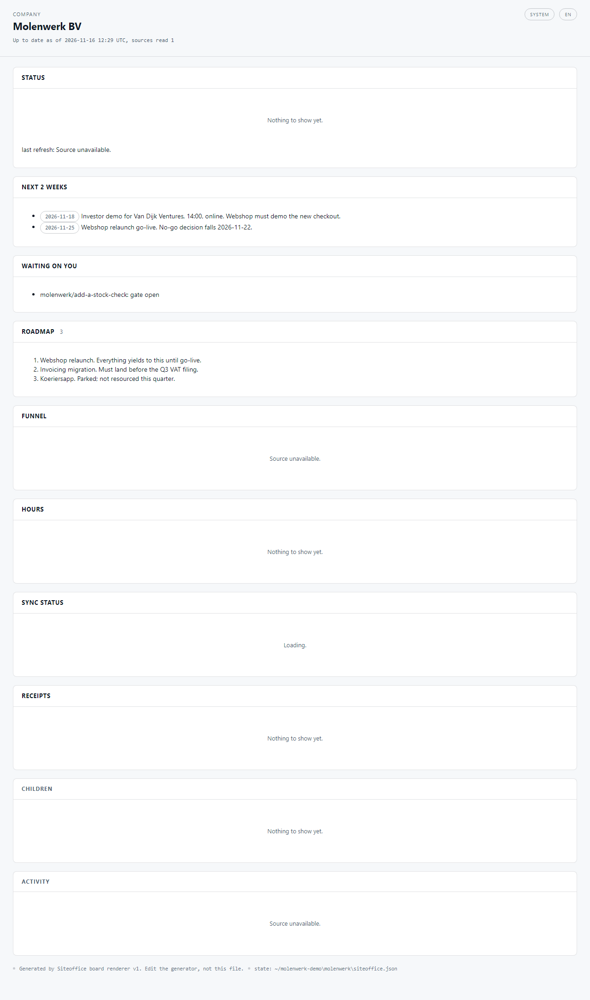
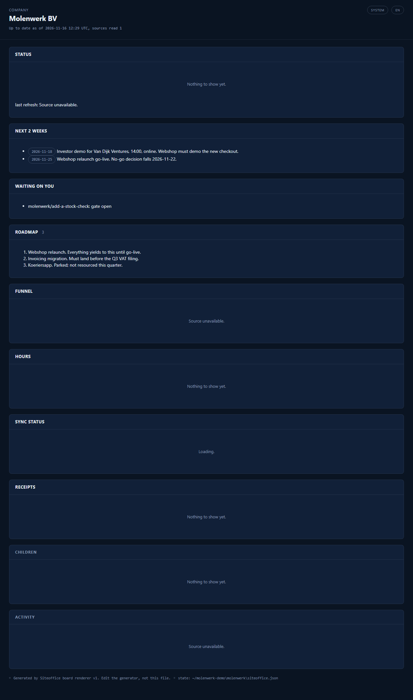
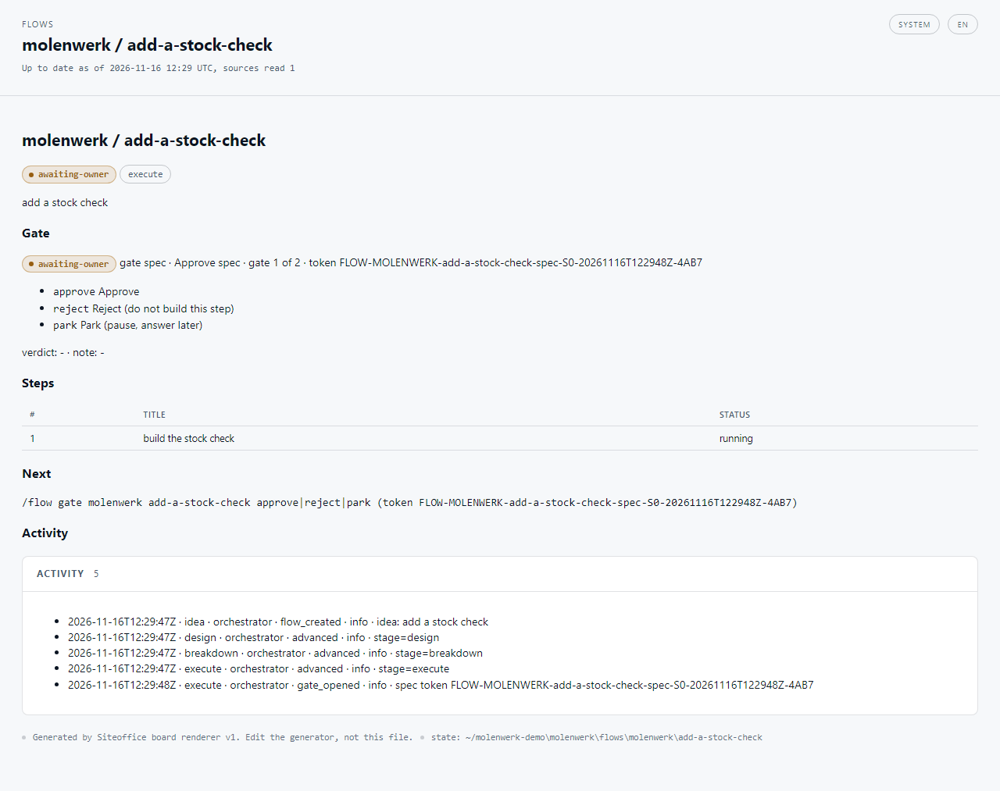
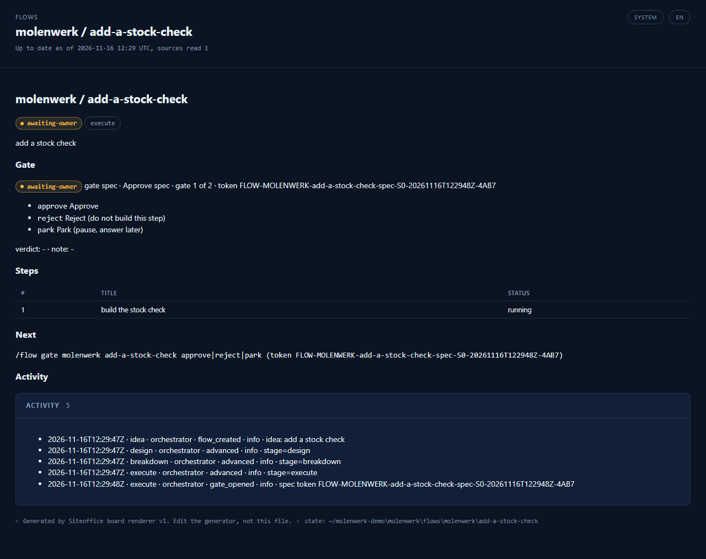
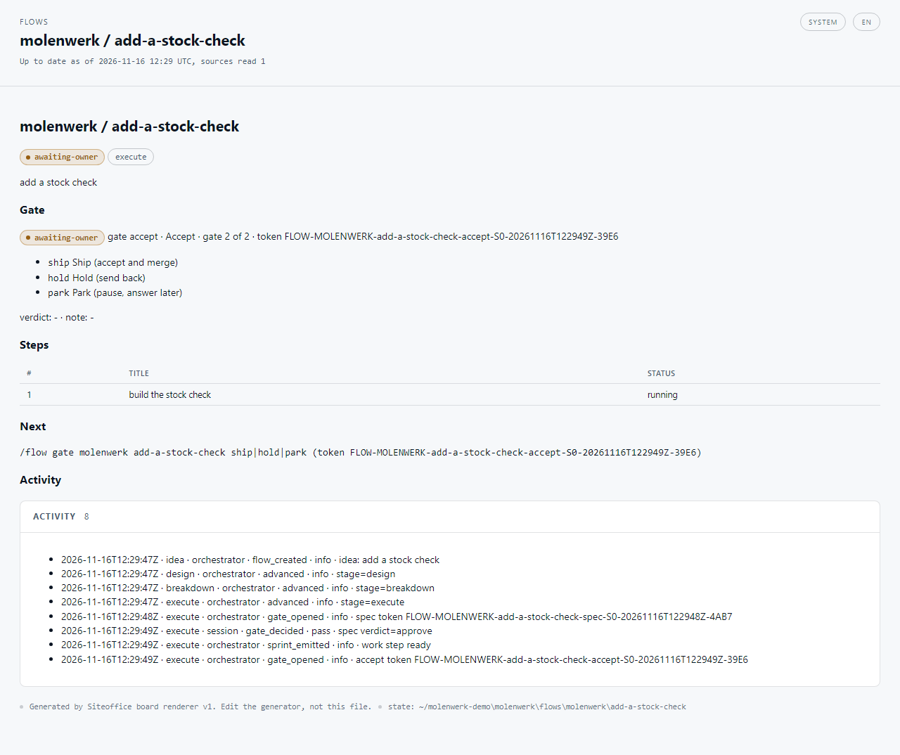
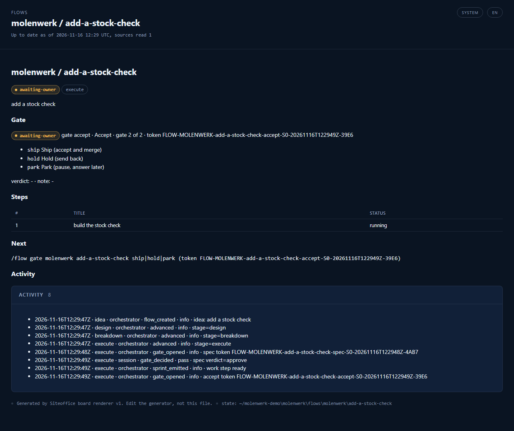
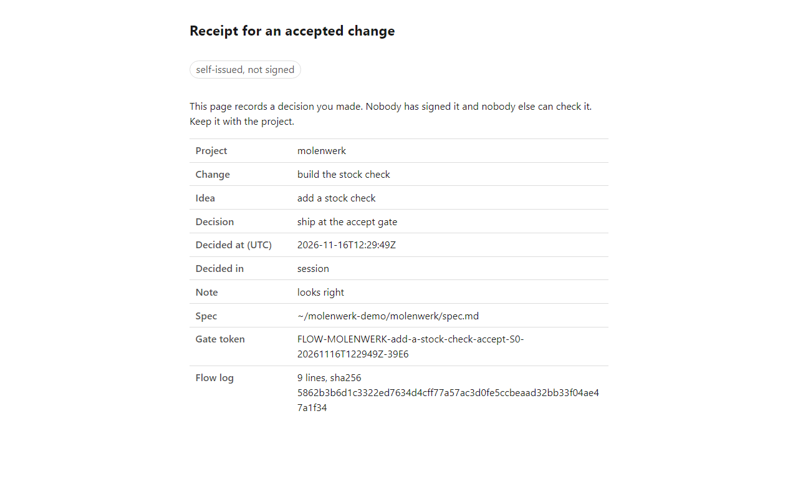
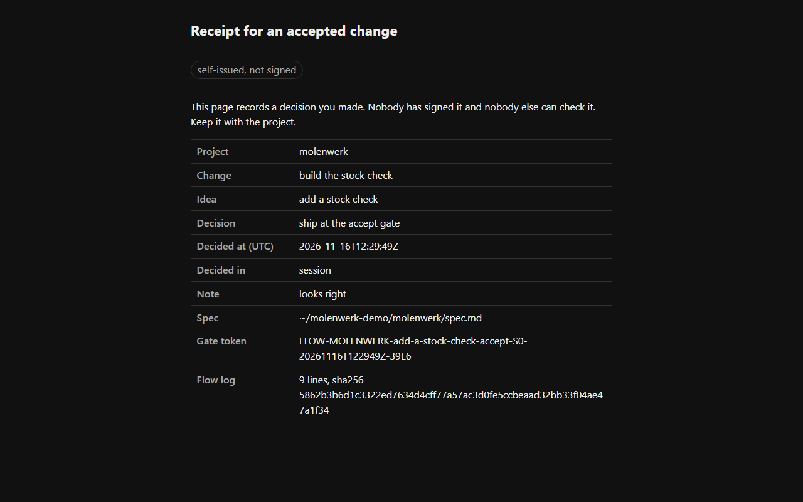
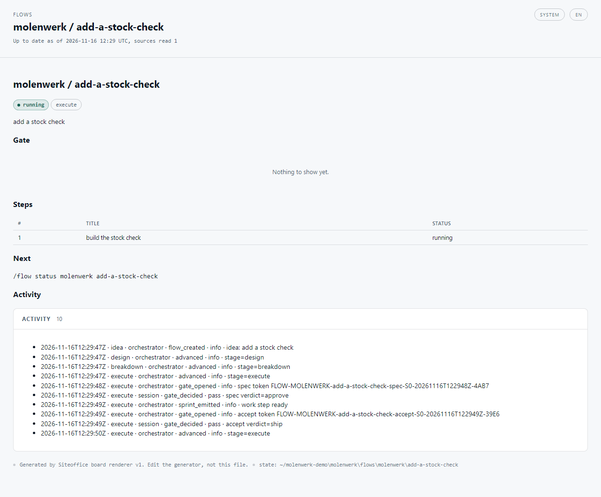
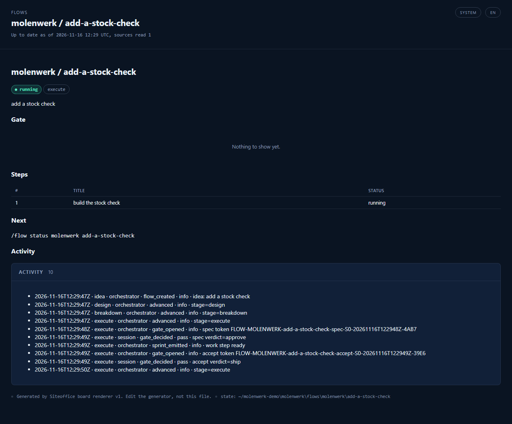

# A tour of the running program

This tour walks one change through Groundwork, screen by screen. It uses the Molenwerk example
company from `templates/molenwerk` and one idea: "add a stock check". Each screen has a light
and a dark picture, then three lines: what you see, what it means, and what you do next. At
each gate you also see the commands. You do not type them. Claude runs them for you when you
answer the gate in plain words, and the output below is what it gets back. `<copy>` stands for
the folder the example was copied to, and `<stamp>` for the time in a gate token.

## Render the pictures yourself

The pictures come from a real run of this release. To make them on your own computer, install
the two tour tools once, then run the script. It copies the example to a temporary folder,
runs the flow, takes the pictures and removes the copy.

```powershell
# runs in: PowerShell on Windows. cwd: the repo root of your checkout.
py -3 -m pip install -r scripts\requirements-tour.txt
py -3 -m playwright install chromium
py -3 scripts\render-tour.py
```

```bash
# runs in: bash or zsh on macOS or Linux. cwd: the repo root of your checkout.
python3 -m pip install -r scripts/requirements-tour.txt
python3 -m playwright install chromium
python3 scripts/render-tour.py
```

The pictures land in `assets/screenshots`. Add `--no-screenshots --write-doc docs/tour.md` to
refresh only the command output in this page, without Playwright.

## 1. The board




**What you see:** The company page for Molenwerk BV. Panels for status, the next two weeks, what waits on you, the roadmap, receipts and recent activity. The next two weeks lists two dated rows, the investor demo and the webshop go-live, and the roadmap lists three priorities. Panels with no data say "Nothing to show yet", "Source unavailable" or "Loading".

**What it means:** This is the whole company at a glance, read from plain files in the folder. The render script moves every date in its temporary copy so the first deadline lands two days after the day you render, and keeps the order and spacing. So nothing is overdue and the next two weeks fills. The example in `templates/molenwerk` keeps its original dates, because the board tests read it. The VAT filing and the lease renewal fall after the two weeks, so they are not listed. The new flow does not show here yet: its gate lives on the flow page.

Some panels are empty in this local example, and that is the truthful answer, not a fault:

- **Status** lists only overdue dates. Nothing is overdue, so it is empty.
- **Funnel** needs a funnel folder, **Activity** reads the `_log` folder, and **Children** needs child nodes. The example has none of them, so Funnel and Activity say "Source unavailable" and Children says "Nothing to show yet".
- **Sync status** waits for a `sync_status.js` file that the sync layer writes after a sync. The example never syncs, so the picture stays on "Loading".
- **Hours** has no logged hours, **Receipts** has none yet at this point of the tour, and **Waiting on you** is empty here because the gate lives on the flow page.

**What you do next:** Nothing on this page. Open the flow page to answer the spec gate, or ask Claude for the flow status.

The flow page is rendered by `render_board.py flows` on your `flows` folder and lands at
`_board\flows\<project>\<slug>\index.html`, next to that `flows` folder:

```powershell
# runs in: PowerShell on Windows. cwd: the repo root of your checkout. <your folder> is your project folder.
py -3 .\plugins\groundwork\board\render_board.py flows <your folder>\flows
```

## 2. The spec gate




**What you see:** The flow "molenwerk / add-a-stock-check" with the badge awaiting-owner, the stage execute, the spec gate with its token, and the one step "build the stock check", counted from 0.

**What it means:** The idea has been shaped and broken into steps, and the flow stopped. The spec gate is gate 1 of 2: before the step is built, Claude writes a short spec of what changes, what stays, and how you check it. You approve the spec, not the code. The flow waits as a saved file, so you can come back tomorrow.

**What you do next:** Read the spec. Say approve, reject or park. After approve, Claude does the work with you in the same session.

<!-- tour:spec -->
<!-- /tour:spec -->

## 3. The accept gate




**What you see:** The accept gate is open. The activity list shows your spec approval, then a `sprint_emitted` line that reads "work step ready". That is engine wording carried over from Siteoffice. Groundwork does not start a sprint or any agent: the work happens in your own session. The line under Next lists the verdicts that count here: ship, hold or park.

**What it means:** The accept gate is gate 2 of 2. Only ship accepts the change and writes a receipt. Hold keeps the work but does not accept it. Park sets the flow aside.

**What you do next:** Look at what changed and what the checks said. Say ship if you accept it, with a short note. Otherwise say hold or park.

<!-- tour:accept -->
<!-- /tour:accept -->

## 4. The receipt




**What you see:** "Receipt for an accepted change", labelled self-issued, not signed. A table with the project, the change, the idea, your decision, the time, your note, the spec, the gate token and a hash of the flow log.

**What it means:** This is your own record that you accepted this step and when. Nobody signed it and nobody else can check it. It lands in `flows/<project>/<slug>/receipts/` as `step-01.html` and `step-01.json`.

**What you do next:** Keep it with the project. Go back to the flow page for the learn step.

## 5. Learn, without a gate




**What you see:** No gate is open. The activity list shows your ship verdict at the accept gate and the move to learn.

**What it means:** Learn has no gate. Claude writes down what held and what broke in `learnings.md` in the flow folder, and the flow moves on by itself: to the next step, or to closed after the last one.

**What you do next:** Nothing waits on you. Ask Claude to run advance to continue.

<!-- tour:learn -->
<!-- /tour:learn -->

After the last step, one more advance closes the flow. That is the whole loop.
