# A tour of the running program

This tour walks one change through Groundwork, screen by screen. It uses the Molenwerk example
company from `templates/molenwerk` and one idea: "add a stock check". Each screen has a light
and a dark picture, then three lines: what you see, what it means, and what you do next. At
each gate you also see the commands. You do not type them. Claude runs them for you when you
answer the gate in plain words, and the output below is what it gets back. `<copy>` stands for
the folder the example was copied to, and `<stamp>` for the time in a gate token.

## Render the pictures yourself

The pictures come from a real run of this release. To make them on your own computer, install
the two tour tools once, then run the script. It copies the example to a temporary folder,
runs the flow, takes the pictures and removes the copy.

```powershell
# runs in: PowerShell on Windows. cwd: the repo root of your checkout.
py -3 -m pip install -r scripts\requirements-tour.txt
py -3 -m playwright install chromium
py -3 scripts\render-tour.py
```

```bash
# runs in: bash or zsh on macOS or Linux. cwd: the repo root of your checkout.
python3 -m pip install -r scripts/requirements-tour.txt
python3 -m playwright install chromium
python3 scripts/render-tour.py
```

The pictures land in `assets/screenshots`. Add `--no-screenshots --write-doc docs/tour.md` to
refresh only the command output in this page, without Playwright.

## 1. The board

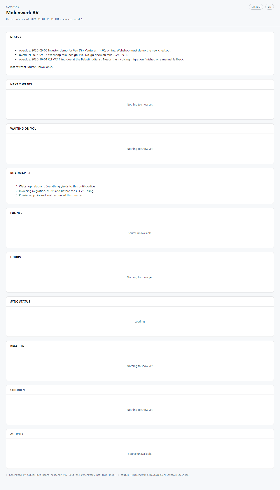
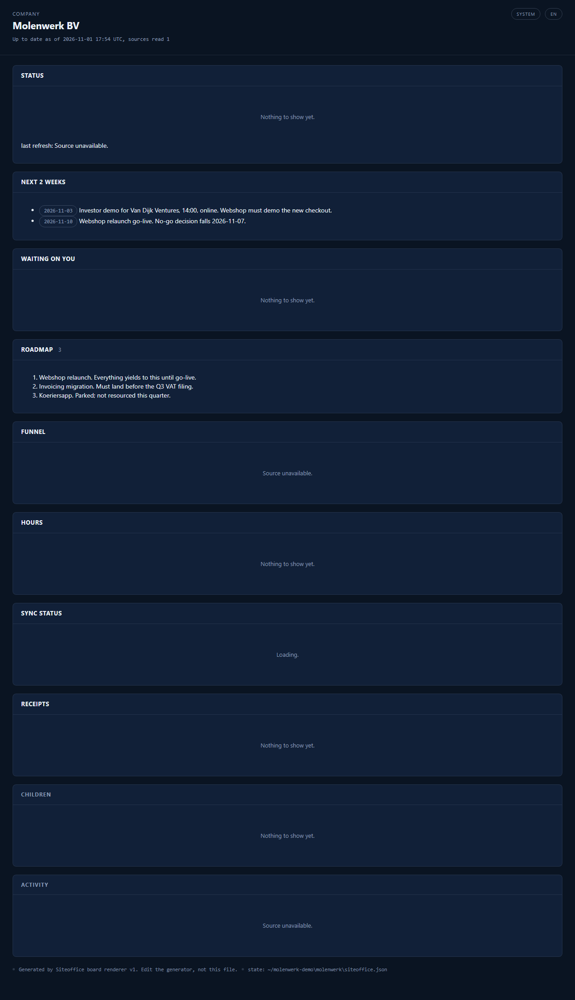

**What you see:** The company page for Molenwerk BV. Panels for status, the next two weeks, what waits on you, the roadmap, receipts and recent activity. Panels with no data say "Nothing to show yet" or "Source unavailable".

**What it means:** This is the whole company at a glance, read from plain files in the folder. The dates in the example are in the past, so they show as overdue. The new flow does not show here yet: its gate lives on the flow page.

**What you do next:** Nothing on this page. Open the flow page to answer the plan gate.

## 2. The plan gate (G1)

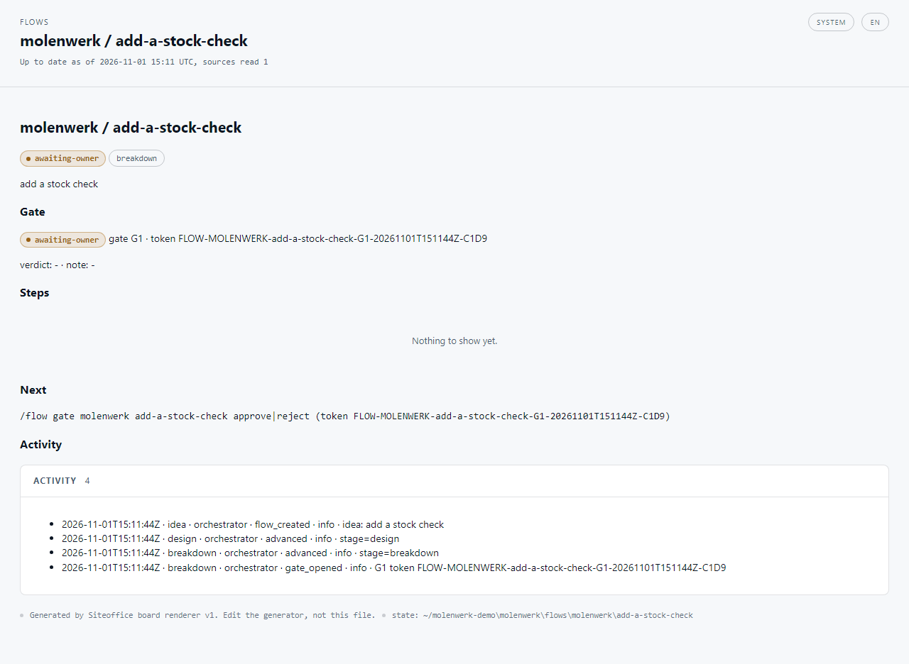
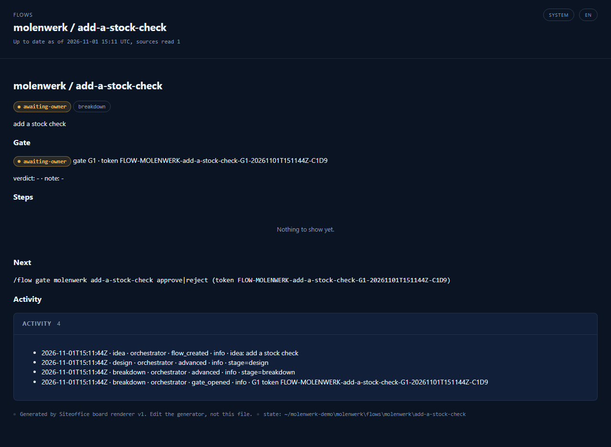

**What you see:** The flow "molenwerk / add-a-stock-check" with the badge awaiting-owner, the stage breakdown, gate G1 with its token, no steps yet, and an activity list of four lines.

**What it means:** The idea has been shaped and the flow stopped. G1 is the plan gate: nothing is built until you approve the plan. The flow waits as a saved file, so you can come back tomorrow.

**What you do next:** Read the plan Claude shows you as a short list of steps. Say approve, reject or park.

<!-- tour:G1 -->
```text
> gw advance molenwerk/add-a-stock-check
stage=breakdown status=awaiting-owner | GATE G1 open, token FLOW-MOLENWERK-add-a-stock-check-G1-<stamp>, verdicts: approve, reject, park
> gw gate molenwerk/add-a-stock-check approve
stage=breakdown status=decided | GATE G1 decided: approve. Run advance to apply it
```
<!-- /tour:G1 -->

## 3. The spec gate (G2)

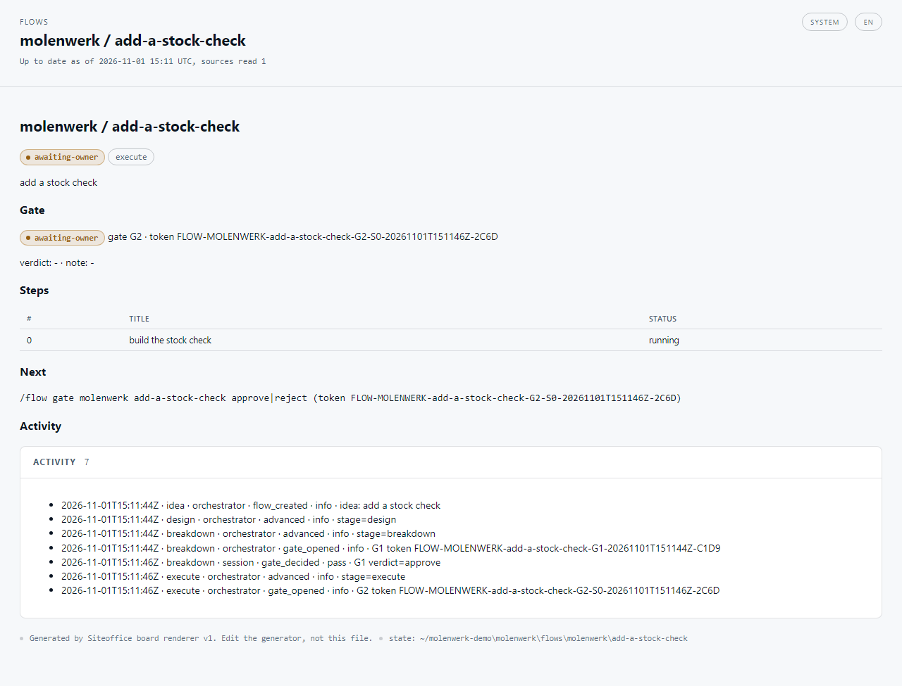
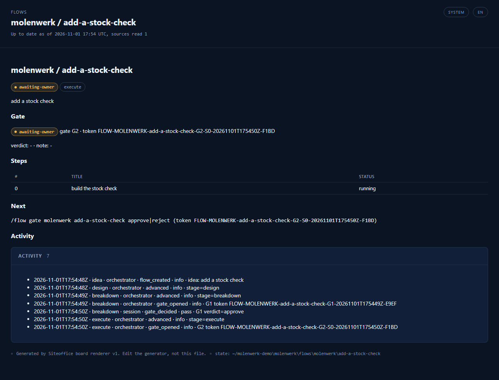

**What you see:** The stage is now execute. The steps table holds one step, "build the stock check", counted from 0. Gate G2 is open, and the activity list shows your G1 approval.

**What it means:** G2 is the spec gate. Before the step is built, Claude writes a short spec: what changes, what stays, and how you check it. You approve the spec, not the code.

**What you do next:** Read the spec. Say approve, reject or park. After approve, Claude does the work with you in the same session.

<!-- tour:G2 -->
```text
> gw advance molenwerk/add-a-stock-check
stage=execute status=awaiting-owner step=1/1 phase=grill | GATE G2 open, token FLOW-MOLENWERK-add-a-stock-check-G2-S0-<stamp>, verdicts: approve, reject, park
> gw gate molenwerk/add-a-stock-check approve
stage=execute status=decided step=1/1 phase=grill | GATE G2 decided: approve. Run advance to apply it
```
<!-- /tour:G2 -->

## 4. The ship gate (G4)

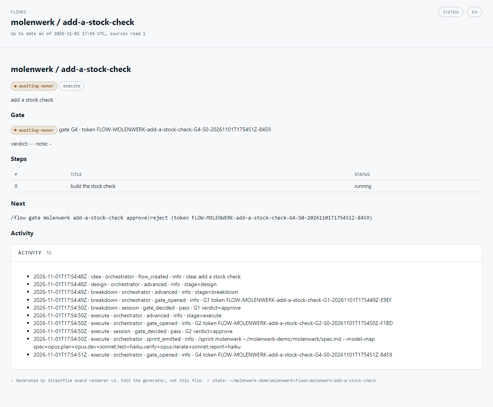
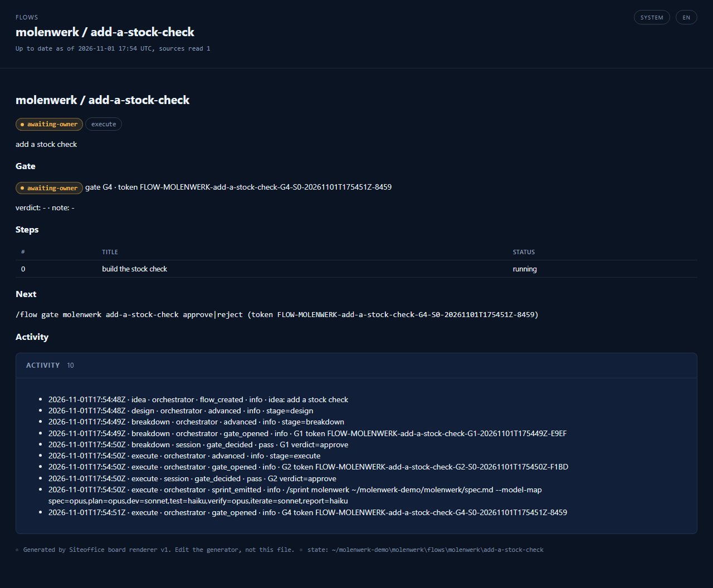

**What you see:** Gate G4 is open. The activity list shows your G2 approval, then a `sprint_emitted` line with a `/sprint` command. That line is engine wording carried over from Siteoffice. Groundwork does not start a sprint or any agent: the work happens in your own session. The line under Next still reads approve or reject: the verdicts that count here are the ones the command prints, ship, hold or park.

**What it means:** G4 is the ship gate, and you meet it before G3. Only ship accepts the change and writes a receipt. Hold keeps the work but does not accept it. Park sets the flow aside.

**What you do next:** Look at what changed and what the checks said. Say ship if you accept it, with a short note. Otherwise say hold or park.

<!-- tour:G4 -->
```text
> gw advance molenwerk/add-a-stock-check
stage=execute status=awaiting-owner step=1/1 phase=sprint | GATE G4 open, token FLOW-MOLENWERK-add-a-stock-check-G4-S0-<stamp>, verdicts: ship, hold, park
> gw gate molenwerk/add-a-stock-check ship "looks right"
stage=execute status=decided step=1/1 phase=sprint | GATE G4 decided: ship. Run advance to apply it
receipt (self-issued, not signed): <copy>/flows/molenwerk/add-a-stock-check/receipts/step-01.html
receipt data: <copy>/flows/molenwerk/add-a-stock-check/receipts/step-01.json
```
<!-- /tour:G4 -->

## 5. The receipt

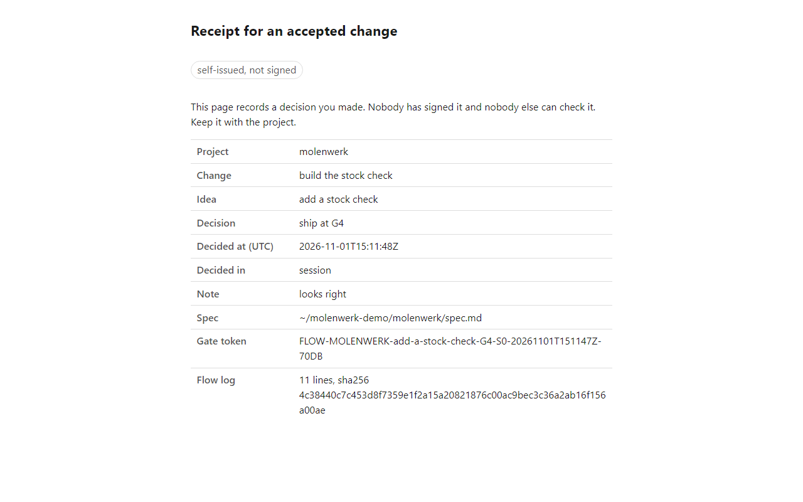
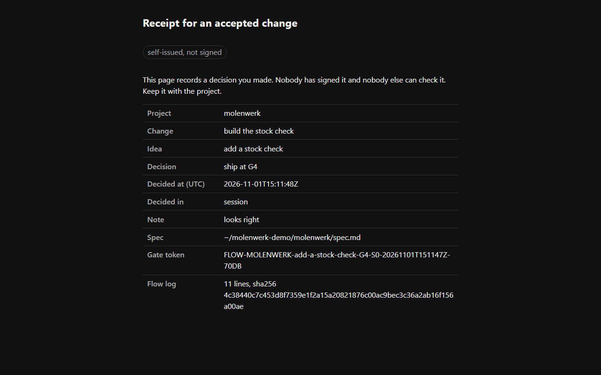

**What you see:** "Receipt for an accepted change", labelled self-issued, not signed. A table with the project, the change, the idea, your decision, the time, your note, the spec, the gate token and a hash of the flow log.

**What it means:** This is your own record that you accepted this step and when. Nobody signed it and nobody else can check it. It lands in `flows/<project>/<slug>/receipts/` as `step-01.html` and `step-01.json`.

**What you do next:** Keep it with the project. Go back to the flow page for the last gate.

## 6. The learn gate (G3)

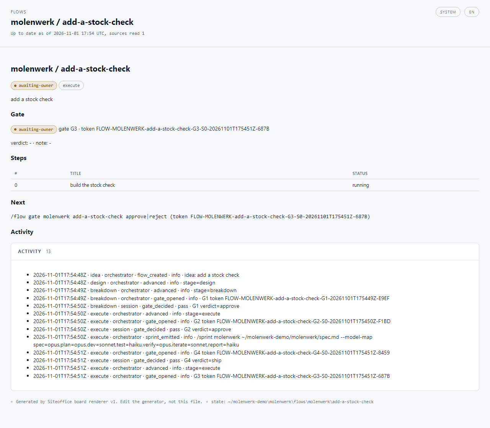
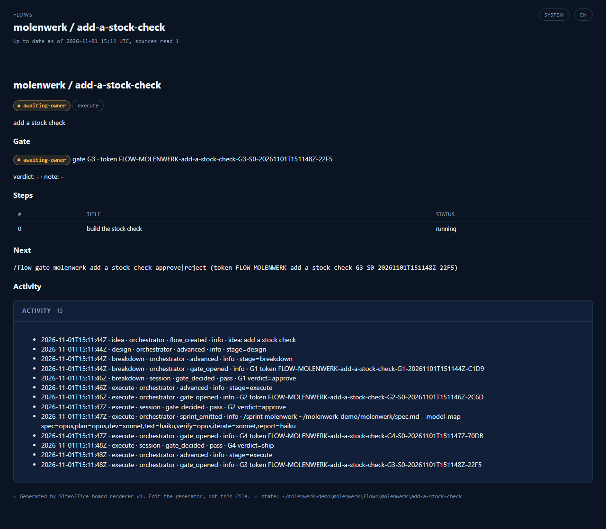

**What you see:** Gate G3 is open. The activity list shows your ship verdict at G4 and the move to learn.

**What it means:** G3 is the learn gate. Claude writes down what held and what broke in `learnings.md` in the flow folder. Then you decide what happens to the rest of the flow.

**What you do next:** Say proceed to go to the next step, or to close the flow if this was the last one. Say adapt to redo this step with a note, close to stop, or park to set it aside.

<!-- tour:G3 -->
```text
> gw advance molenwerk/add-a-stock-check
stage=execute status=awaiting-owner step=1/1 phase=learn | GATE G3 open, token FLOW-MOLENWERK-add-a-stock-check-G3-S0-<stamp>, verdicts: proceed, adapt, close, park
> gw gate molenwerk/add-a-stock-check proceed
stage=execute status=decided step=1/1 phase=learn | GATE G3 decided: proceed. Run advance to apply it
```
<!-- /tour:G3 -->

After the last proceed, one more advance closes the flow. That is the whole loop.
